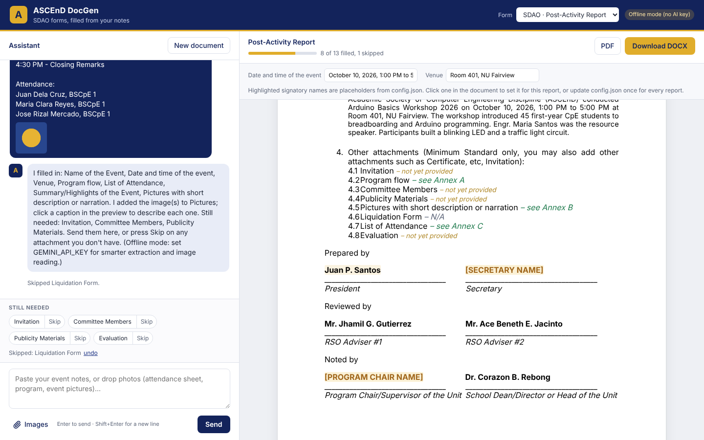

# ASCEnD DocGen

AI-assisted filling of SDAO forms for ASCEnD. Officers paste rough notes or drop
photos and files (PDF, Word, PowerPoint, Excel, CSV, text) into a chat on the left; the assistant puts each fact into the right
field of the form, asks for anything missing (or lets you skip it), and the
right side shows the filled document live. Click anything on the document to
edit it, then download it as DOCX or PDF. No login.

Forms included:

- **SDAO Post-Activity Report** (from `source_forms/POST-EVENT-REPORT.docx`)
- **ASCEnD Activity Proposal** (from `source_forms/ACTIVITY-PROPOSAL.docx`): the form's own styled
  tables (Activity Overview, Budget, Programme Flow) are filled row by row and the budget TOTAL
  is added up automatically. The AI picks the fitting NU core values (Resilience, Patriotism,
  Innovation, Integrity, Compassion).
- **SDAO Financial Report** (ICB-SDA-2026-007, from `source_forms/FINANCIAL-REPORT.pdf`): SDAO only
  gave a PDF, so `tools/build_financial_report_template.py` rebuilds it in Word with the PDF's own
  letterhead and watermark images (`tools/assets/financial_report/`).

## Events

Pick **Event → + New event…** at the top to create one (e.g. "Arduino Basics Workshop 2026") and
save what you know about it: notes, and files such as the concept paper, program, receipts or photos.
Every form opened under that event can then be filled with **Fill from event info**, and its draft is
saved inside the event, so the proposal written before the activity and the post-activity report
written after it share the same facts. New facts you tell the assistant in an event's chat (attendance,
speakers, ratings...) are added to the event automatically (marked "AI" under Event info).
"Quick draft (no event)" works as before and stays in your browser only.

Events are shared by everyone who can open the app (this tool is for ASCEnD only; set
`ASCEND_PASSWORD` when it is online).

### Where data is kept

- **Firebase (recommended, free):** with `FIREBASE_CREDENTIALS` set, events, drafts and every
  uploaded file are kept in Cloud Firestore (`app/storage.py`), so they survive restarts and the PC
  and the online version share the same events. Uses Firebase's free Spark plan (1 GB); large photos
  are scaled down to 2000 px on upload to make it last.
  1. Firebase console → Firestore Database → Create database (production mode, `asia-southeast1`).
  2. Project settings → Service accounts → Generate new private key.
  3. Locally, put `FIREBASE_CREDENTIALS=<path to the .json>` in a `.env` file in the project root.
     On Render, paste the whole contents of the .json as the `FIREBASE_CREDENTIALS` secret.
  The key gives full access to the Firebase project: never commit it (`.gitignore` blocks the usual
  key file names) or share it. Production-mode rules keep browsers out; only the server reads the data.
- **Without Firebase:** events in SQLite at `data/ascend.db` (`ASCEND_DB` to change) and uploads in
  `data/uploads/` on the server's own disk.



## Run it

Needs Python 3.10+. LibreOffice is optional. It is used for the PDF button
(without it the button falls back to the browser's "Save as PDF") and for reading
old-format uploads (.doc, .ppt, .xls, .odt, .odp, .ods).

```bash
cd ascend-docgen
python -m venv .venv && source .venv/bin/activate      # Windows: .venv\Scripts\activate
pip install -r requirements.txt

export GEMINI_API_KEY=your-key       # Windows PowerShell: $env:GEMINI_API_KEY="your-key"
uvicorn app.main:app --reload
```

Open http://localhost:8000.

**Each user can use their own Gemini key**: click the badge at the top right
(it says "Offline mode · add API key" when no key is set) and paste a key. It is
saved only in that browser (localStorage) and sent with each chat request in the
`X-Gemini-Key` header. The server uses it for that request and never stores or
logs it. A user's own key takes priority over the server's `GEMINI_API_KEY`, so
the server key is optional.

With no key at all the app runs in **offline mode**: a rule-based parser
that understands notes like `Event: ...`, `Date: ...`, `Venue: ...` and lists
under `Program flow:` / `Attendance:` / `Committee:` headings. It cannot read
images, but it does read the text of uploaded documents. Get a free Gemini key at https://aistudio.google.com/apikey.

| Env var | Default | Meaning |
|---|---|---|
| `GEMINI_API_KEY` | (none) | Server-wide Gemini key for users who haven't entered their own (optional) |
| `GEMINI_MODEL` | `gemini-2.5-flash` | Any Gemini model that accepts images |
| `AI_PROVIDER` | auto | `gemini` or `offline`; auto picks gemini when a key is set |
| `ASCEND_CONFIG` | `config.json` | Path to the signatories/organization config |
| `ASCEND_UPLOAD_DIR` | `data/uploads` | Where uploaded images and documents are kept |
| `ASCEND_DB` | `data/ascend.db` | SQLite file holding the events (when Firebase is not used) |
| `FIREBASE_CREDENTIALS` | (none) | Firebase service-account key (path or JSON): keep events and uploads in Firestore |
| `ASCEND_PASSWORD` | (none) | Shared password for the whole app (recommended when online) |

Tests: `pip install pytest && python -m pytest -q`

## Put it online (Render)

The repo has a `Dockerfile` (includes LibreOffice, so PDF export and old Office
formats work) and a `render.yaml` blueprint.

1. Sign in at https://render.com with GitHub.
2. **New > Blueprint**, pick this repository, and fill in:
   - `GEMINI_API_KEY`: optional. Leave it empty if every officer will enter their own key in the app
   - `ASCEND_PASSWORD`: the password officers type to open the app (any username works)
   - `FIREBASE_CREDENTIALS`: the whole contents of the Firebase service-account .json
3. Deploy. The app is served at `https://ascend-docgen-xxxx.onrender.com`.

Every push to `main` redeploys. On the free plan the app sleeps after 15 minutes
without visitors (the next visit takes about a minute to wake up) and its disk is wiped on
every restart, so set `FIREBASE_CREDENTIALS` (see "Where data is kept"): events and uploads
then live in Firestore and nothing is lost.
`ASCEND_PASSWORD` works on any host; when it is unset the app is open.

## Signatories (`config.json`)

Static names are filled automatically on every form:

- RSO Adviser #1: Engr. Jhamil G. Gutierrez, MSCpE
- RSO Adviser #2 (co-adviser): Engr. Mary Jane F. Somao-i, MSCpE
- Program Chair: Engr. Jhamil G. Gutierrez, MSCpE
- School Dean: Dr. Corazon B. Rebong, PCpE

**President and Secretary are placeholders** (`[PRESIDENT NAME]` etc.)
because we don't have the names yet. Put them in `config.json` once and every
report uses them. A name can also be changed for one report by clicking it in
the preview; placeholders show highlighted until set.

## How it works

```
web/ (vanilla JS)          app/main.py (FastAPI)
  chat + images  ──POST /api/chat──▶  ai provider (Gemini | offline) ──▶ field updates
                                        └ registry.merge_updates validates them against the schema
  live preview   ◀─POST /api/preview─  engine.render_html  (template.docx → editable HTML)
  DOCX / PDF     ◀─POST /api/export/*─ engine.fill_docx    (python-docx; LibreOffice for PDF)
```

- Document state is plain JSON kept in the browser's localStorage, so a draft
  survives a refresh. Uploaded images are stored on the server.
- Uploaded documents (`app/files.py`) are stored in `data/uploads/docs/`. Their
  text is extracted and sent to the AI with the message (up to 30,000 characters
  per file). PDF pages (up to 10) are also turned into images, so a scanned
  invitation or liquidation form can go into the report as an annex. Supported:
  .pdf .docx .pptx .xlsx .txt .md .csv .tsv .json .rtf, plus .doc .ppt .xls .odt
  .odp .ods when LibreOffice is installed. Max 25 MB per file.
- The preview is rendered from the same `template.docx` as the download, so
  what you see is what prints (fonts and line breaks can differ slightly from Word).
- Attachments that are provided become annex pages after the signatures
  (Annex A, B, ... in checklist order) and the checklist says "– see Annex B";
  skipped ones say "– N/A".

## Adding another SDAO form

Each form is a folder in `templates/`; no code changes are needed.

1. Copy the blank form into `templates/<form_id>/template.docx`.
2. In Word, replace the blanks with tokens (type each token in one go so Word keeps it in one run):
   - `{{field_id}}` inline text, for example after "Name of the Event:"
   - `{{#field_id}}` alone on its own line for multi-paragraph text, a table, or images
   - `{{sig:role}}` for a signatory name (roles come from `config.json`)
   - `{{annex:field_id}}` next to an attachment in a checklist
   - `{{#annexes}}` on its own line where annex pages should start
   - `{{title:role}}` for a signatory's position (editable per document)
   - `{{rows:field_id}}` in the first cell of a row of the form's own table: that row is
     repeated once per row of the table field, keeping the table's colors and borders
   - `{{total:field_id}}` for the sum of a table field's `total_column` (with `currency`)
3. Write `templates/<form_id>/schema.json` listing the fields. Copy
   `templates/post_activity_report/schema.json` and edit it. Field types:
   `text`, `longtext`, `table` (with `columns`, optional `numbered`), `images`.
   Useful keys: `required`, `attachment` + `annex_title`, `hint` (tells the AI
   what to write), `default` (e.g. `"{organization.name}"`, or another field such as
   `"{event_name}"`), `in_document: false` for facts the AI should collect but not print.
   Form-level keys: `ai_instructions` (rules for the AI that only apply to this form),
   `greeting` (the assistant's first message), `signatories` (role -> position label).
4. Restart the server. The form appears in the "Form" dropdown.

The templates are produced by `tools/build_post_activity_template.py` and
`tools/build_activity_proposal_template.py`, which edit the original files so their
layout, header/footer art and fonts stay untouched. Re-run one if its form is updated.
The preview shows the header/footer art and the form's tables as in Word, but as one
long page; the downloaded DOCX/PDF has the real page breaks.

## Adding another AI provider

Subclass `AIProvider` in `app/ai/base.py`, implement `extract()` (the shared
prompt in `app/ai/prompt.py` can be reused), and add it to `get_provider()`.

## Project layout

```
app/main.py          API routes, uploads, export
app/registry.py      template registry, field validation, missing-field logic
app/engine.py        docx filling + HTML preview
app/files.py         reading uploaded documents (PDF, Word, PowerPoint, Excel, text)
app/events.py        events: saved notes, files and drafts per activity
app/storage.py       where events and uploads are kept: SQLite + local disk, or Firestore
app/ai/              provider interface, Gemini, offline parser, prompt
templates/<id>/      schema.json + template.docx per form
source_forms/        original blank SDAO forms
tools/               scripts that turn an original form into a template
web/                 index.html, app.js, styles.css
examples/            sample notes and the report generated from them
```

## Known limits of this draft

- No accounts; one shared password (`ASCEND_PASSWORD`) protects the whole app. Without it, anyone who can open the server can use it.
- Uploaded images are never cleaned up automatically (`data/uploads`).
- The AI step is only as good as the notes. Always review the preview before
  submitting to SDAO; the assistant is told not to invent names or dates.
